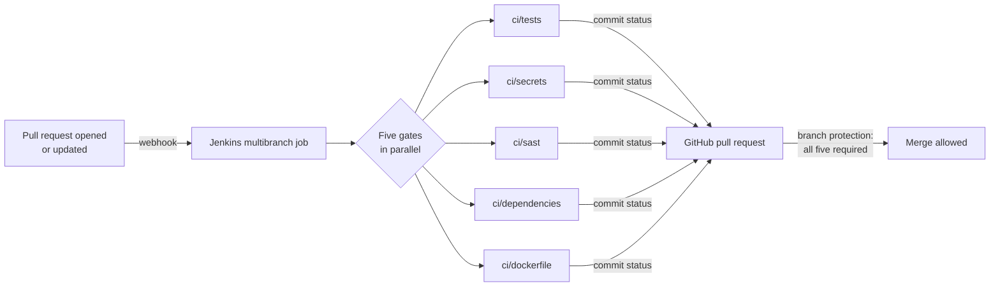

# jenkins-pr-checks-security-gates

Pull request checks with security gates, on a Jenkins controller running on Oracle Cloud
Infrastructure. Every pull request runs five gates in parallel and reports each one back to
GitHub as its own status check. Branch protection on `main` requires all five, so nothing is
merged until tests, secret scanning, static analysis, dependency scanning and Dockerfile
linting all pass.

Lab 8 of a series of CI/CD labs on OCI (GitHub · Jenkins · Docker · Oracle Linux). The sample
application is the Inventory API from the earlier labs; the pipeline uses the
[ci-labs shared library](https://github.com/abdulzaferdevops/jenkins-shared-library) (Lab 6).

## Flow

## Gates

| Status check | Tool | Fails when |
|:--|:--|:--|
| `ci/tests` | flake8, pytest, pytest-cov | lint error, failing test, or coverage below 90% |
| `ci/secrets` | gitleaks 8.21 | a secret anywhere in the git history (output redacted) |
| `ci/sast` | bandit 1.7 | a finding of medium or higher severity **and** confidence |
| `ci/dependencies` | Trivy 0.56 | a HIGH or CRITICAL vulnerability that has a fixed version |
| `ci/dockerfile` | hadolint 2.12 | a warning or error in the Dockerfile |

Each gate reports `pending` when the build starts and `success` or `failure` when it ends. All
five always run, so one pull request shows every problem at once rather than one per push.

## Design decisions

- **Gates run on a copy, not a mount.** `ci/in-container.sh` creates a throwaway container,
  copies the workspace into it with `docker cp`, runs the check, and copies the reports back.
  Earlier labs used `--volumes-from` the Jenkins container, which also exposes `JENKINS_HOME`
  (credentials, other jobs). Here, test code and dependencies from a pull request cannot read
  Jenkins' secrets.
- **No pull requests from forks.** Building a fork runs a stranger's code on a controller
  that can reach Docker. Only branches in this repository are discovered.
- **The pull request head is built, and branch protection requires it to be up to date with
  `main`.** That gives the same guarantee as building a merge commit, and the statuses land on
  a commit GitHub knows.
- **Reporting fails safe.** If Jenkins cannot post a status, the required check is missing
  and GitHub still blocks the merge.
- **A new push cancels the previous run** for the same pull request
  (`disableConcurrentBuilds(abortPrevious: true)`).
- **Secrets are scanned across history**, not just the latest commit: deleting a key in a
  later commit leaves it in git history, and the key must be rotated.

## Jenkins setup

- Multibranch Pipeline, branch source **GitHub**, credential: a fine-grained personal access
  token limited to this repository (Commit statuses: read and write; Contents, Pull requests:
  read-only).
- Behaviours: discover branches (excluding branches that are also pull requests), discover
  pull requests from origin (the current pull request revision), no fork discovery.
- Webhook events: pushes and pull requests.

## Results

| Pull request | Change | Gates |
|:--|:--|:--|
| [FILL: #] | `?sort=` implemented with `eval` | [FILL] |
| [FILL: #] | fixed with an allow-list | [FILL] |
| [FILL: #] | API key committed in `config.py` | [FILL] |
| [FILL: #] | `urllib3==1.26.4` added | [FILL] |

## Licence

MIT
